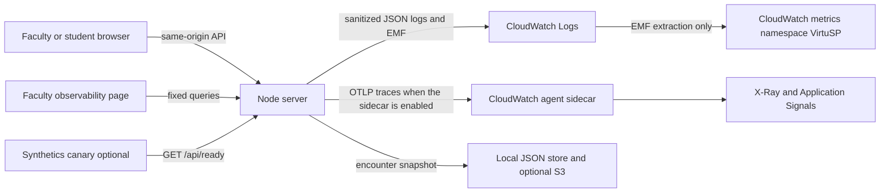

# Observability

> Scope clarification: basic ECS dashboards/alarms in `monitoring.tf` have historical deployment observations in the handoff. The “not cloud verified” statements here concern this instrumentation change and optional Application Signals/Synthetics resources, not absence of every CloudWatch deployment. No AWS resources were queried or applied in this documentation audit. Current local check results: [TESTING.md](TESTING.md).

Status of this tree: **IMPLEMENTED AND LOCALLY VERIFIED** for the in-process path. CloudWatch dashboards, alarms, Synthetics, and the Application Signals sidecar are **IMPLEMENTED BUT NOT CLOUD VERIFIED**. Nothing in this document was applied to the AWS account during this change.

## Architecture



The encounter snapshot is the durable record. CloudWatch does not replace it. Domain metrics have one export path: an Embedded Metric Format line on stdout, which the existing awslogs driver ships. The process does not call `PutMetricData` for those metrics, and Terraform does not add a metric filter for the same names. `OTEL_METRICS_EXPORTER` and `OTEL_LOGS_EXPORTER` are `none` so the trace SDK cannot publish a second copy.

Traces use manual spans. Automatic HTTP and AWS SDK instrumentation is not loaded, because those libraries can capture headers and bodies. When `OTEL_EXPORTER_OTLP_TRACES_ENDPOINT` is empty, spans stay in the process. When the sidecar is enabled, spans go to `http://127.0.0.1:4316/v1/traces`. That port is the CloudWatch agent Application Signals receiver, not the generic OTLP example on 4318 in the X-Ray migration guide. The sidecar config is `infra/aws/cloudwatch-agent.json` and only collects `application_signals`. Sending OTLP alone does not enable Application Signals; the agent config and the span attributes `aws.local.service` and `aws.local.operation` are both required, and this has not been confirmed on a live task. Account-level Application Signals discovery is a separate one-time console step and was not performed.

Pinned packages, verified to load in `tests/observability.test.js`: `@opentelemetry/api` 1.9.0, `@opentelemetry/sdk-trace-node` 1.30.1, `@opentelemetry/sdk-trace-base` 1.30.1, `@opentelemetry/resources` 1.30.1, `@opentelemetry/exporter-trace-otlp-http` 0.57.2, `@aws-sdk/client-cloudwatch` 3.1149.0, and `@aws-sdk/client-cloudwatch-logs` 3.1149.0. The faculty read path uses `SEARCH` expressions that include `Operation`, because an exact dimension query that omits `Operation` would not see these Embedded Metric Format series. A series with no datapoints stays null. It is not shown as zero.

Sampling is head sampling for successful traces (`OBS_TRACE_SAMPLE_RATIO`, 1 locally and 0.1 on the ECS task). Error spans are kept when the in-process buffer of 256 spans has room. A full buffer increments `TelemetryDropped`. Client `traceparent` headers are ignored, so a browser cannot force a trace to be kept. Required encounter records are written on the store path and are not sampled.

## Metric catalog

Namespace `VirtuSP`. Dimensions are only `Environment`, `Service`, `Operation`, `Outcome`, `Provider`, `ModelAlias`, and `ExecutionMode`, and only the subset listed for that metric. Request ids, encounter ids, student ids, profile ids, and error strings are not dimensions.

| Name | Unit | Type | Producer | Dimensions | Export | Missing data |
| --- | --- | --- | --- | --- | --- | --- |
| ApiRequest | Count | counter | HTTP wrapper | Environment, Service, Operation, Outcome | emf-stdout | No point is not success |
| ApiEligible | Count | counter | HTTP wrapper | Environment, Service, Operation, Outcome | emf-stdout | Excludes liveness, static, 4xx input, and cancellations |
| ApiLatency | Milliseconds | distribution | HTTP wrapper | Environment, Service, Operation | emf-stdout | One point per eligible request |
| EncounterStarted | Count | counter | engine.create | Environment, Service, Operation, Outcome | emf-stdout | Unpublished starts are StudioOperation, not this counter |
| EncounterCompleted | Count | counter | engine.complete | Environment, Service, Operation, Outcome | emf-stdout | Completion and feedback are separate |
| TurnEligible | Count | counter | engine.ask | Environment, Service, Operation, Outcome | emf-stdout | Duplicates and invalid input are excluded. An approved fallback is success |
| TurnLatency | Milliseconds | distribution | engine.ask | Environment, Service, Operation | emf-stdout | Eligible turns only |
| ApprovedResponseLatency | Milliseconds | distribution | engine.ask | Environment, Service, Operation | emf-stdout | Time to the approved line. Not time to first token |
| PersistenceLatency | Milliseconds | distribution | store.save | Environment, Service, Operation | emf-stdout | Local rename |
| PersistenceFailure | Count | counter | store.save | Environment, Service, Operation, Outcome | emf-stdout | The request fails when this increments |
| DisclosureDecision | Count | counter | disclose, release, denied artifact | Environment, Service, Operation, Outcome | emf-stdout | `unauthorized_attempt` is not a disclosure |
| ValidationOutcome | Count | counter | turn validation | Environment, Service, Operation, Outcome | emf-stdout | `blocked_before_delivery` is not `confirmed_unsupported_delivered` |
| ProviderAttempt | Count | counter | provider wrapper | Environment, Service, Operation, Outcome, Provider, ModelAlias, ExecutionMode | emf-stdout | One per try |
| ProviderLogicalRequest | Count | counter | provider wrapper | Environment, Service, Operation, Outcome, Provider, ModelAlias, ExecutionMode | emf-stdout | One per application call, after retries |
| ProviderLatency | Milliseconds | distribution | provider wrapper | Environment, Service, Operation, Provider | emf-stdout | Per attempt |
| FallbackUsed | Count | counter | turn | Environment, Service, Operation, Outcome | emf-stdout | Also a successful approved reply |
| TokenInput | Count | counter | provider wrapper | Environment, Service, Provider, ModelAlias | emf-stdout | Omitted when unreported |
| TokenOutput | Count | counter | provider wrapper | Environment, Service, Provider, ModelAlias | emf-stdout | Omitted when unreported |
| TokenCacheRead | Count | counter | provider wrapper | Environment, Service, Provider, ModelAlias | emf-stdout | Omitted when unreported |
| EstimatedModelCostMicroUsd | Count | counter | provider wrapper | Environment, Service, Provider, ModelAlias | emf-stdout | Omitted when price or usage is missing |
| FeedbackEligible | Count | counter | engine.complete | Environment, Service, Operation, Outcome | emf-stdout | `not_assessed` domains are not a zero score |
| FeedbackLatency | Milliseconds | distribution | engine.complete | Environment, Service, Operation | emf-stdout | Includes local provisional feedback |
| ObjectiveCoverage | Count | counter | engine.complete | Environment, Service, Operation, Outcome | emf-stdout | `not_elicited` is the student record. `not_assessed` is the system |
| StudioOperation | Count | counter | publish path | Environment, Service, Operation, Outcome | emf-stdout | Validation findings use bounded categories |
| AuditFailure | Count | counter | audit append | Environment, Service, Operation, Outcome | emf-stdout | The operation is failed |
| TelemetryHeartbeat | Count | counter | server interval | Environment, Service | emf-stdout | Silence is the stale alarm |
| TelemetryDropped | Count | counter | buffer and export | Environment, Service, Operation, Outcome | emf-stdout | Includes export failure |
| EncounterConflict | Count | counter | per-encounter queue | Environment, Service, Operation, Outcome | emf-stdout | The second action waits; it is not dropped |

Retries: Bedrock calls in `lib/cloud.js` use `maxAttempts: 1`. The wrapper can count up to three tries. Logical success increments once. Token and cost estimates, when present, are per attempt.

Percentiles are CloudWatch `p95` over the raw points in the period. They are not averages of per-task percentiles.

Initial engineering objectives, not measured claims:

- 99.5% eligible API success.
- 95% of eligible turns deliver an approved reply within 5 seconds.
- 99% of feedback requests finish within 30 seconds.

The operator page shows the sample count, the window, and `insufficient_data` when there are no points. It does not display 100% for an empty window.

Safety counters are separate. `confirmed_unsupported_delivered` is the zero-tolerance delivery counter. A blocked reply does not increment it.

## Privacy and access

Operational logs use schema `virtusp.telemetry.v1` and an allowlist. Question text, names, emails, prompts, completions, artifact names, and object keys are not fields. `lib/observability/sanitize.js` redacts strings that look like secrets, emails, or presigned URLs before they can be stored as an error code.

`enc.auditTrail` is the protected audit on the encounter object. It stores an operation, a bounded reason, a count of fact references, and ids. It does not store the question or the reply. `publicView` does not return it. Students receive 403 from `/api/observability/*`. The faculty demo role is the existing session check.

A CloudWatch Logs data-protection policy is in Terraform as a second layer for email addresses and AWS secret keys. It is not a substitute for the allowlist, and it has not been applied.

The faculty page builds trace and log console links only when `OBS_AWS_READ=true`. Queries are fixed templates. Encounter ids are checked as UUIDs before they are placed in a Logs Insights query.

Workload IAM is the ECS task role. Read permissions and the sidecar write permissions are off unless `observability_aws_read` or `enable_application_signals` is true. `GetMetricData`, `DescribeAlarms`, `GetQueryResults`, and the X-Ray put and read actions do not support resource-level permissions; those statements use `*` and are commented in `infra/aws/observability.tf`. No AWS keys are placed in the browser.

This deployment does not establish HIPAA compliance or clinical validation.

## Local setup

```powershell
npm ci
npm run obs:test
npm run obs:smoke
npm run obs:validate
npm run obs:local
```

`OBS_ENABLED=false` turns the extra work off. Local mode does not call Bedrock. `npm run obs:local` prints a JSON summary from a synthetic encounter and the label `Local synthetic test telemetry`.

## AWS prerequisites and commands

The stack remains `infra/aws`. Do not apply these resources until the cost and the task-definition change are accepted.

```powershell
terraform -chdir=infra/aws init
terraform -chdir=infra/aws plan -input=false -out=tfplan-observability
terraform -chdir=infra/aws apply tfplan-observability
```

Rollback of an application image is the existing ECS deploy script with the previous image tag. Terraform rollback of the observability resources is `terraform -chdir=infra/aws plan -destroy` only after review. `npm run obs:teardown-plan` prints that command and does not run it. The database and load balancer have deletion protection.

Flags that stay false until an approved apply:

- `enable_application_signals` adds the CloudWatch agent sidecar and requires `task_memory` of at least 2048. Pin `cloudwatch_agent_image` to a digest first. The image default `latest` is not a production pin.
- `enable_synthetics` creates a canary, a private artifact bucket, and a role. `start_canary` is false. Set `synthetics_health_hostname` to the CloudFront hostname. Starting the canary is a separate console or CLI action.
- `observability_alarms_enabled` creates alarms. The heartbeat alarm treats missing data as breaching, so enable it only after the instrumented task is emitting.
- `observability_alarm_email` creates an SNS subscription. Delivery is not confirmed until the recipient confirms it and a test notification is observed. This change did not send email.
- `observability_aws_read` lets the task read its log group and metrics for the faculty page.
- `monthly_budget_usd` creates a budget notification. A budget is not a spending cap.

`npm run obs:plan` runs `terraform plan` when the binary exists and does not apply. `npm run obs:verify-aws` does not query CloudWatch unless `OBS_AWS_READ=true` and `--confirm` are both set, and even then this copy only prints the intended query. No live query was run.

## Cost assumptions

These are planning figures, not a bill. Prices change, and a budget alarm will not stop spend.

| Item | Assumption | Rough monthly effect |
| --- | --- | --- |
| Custom metrics | About 30 series in `VirtuSP` at low cardinality | A few dollars if the series stay bounded |
| Logs | 14-day retention, a few GB from the existing task logs plus EMF lines | Existing log ingestion plus a small EMF increment |
| Traces | 10% of successful requests, errors kept when the buffer allows | Depends on X-Ray and Application Signals pricing after the sidecar is on |
| Dashboards | 6 dashboards, occasional faculty queries, 15-second server cache, 2 in-flight queries | Dashboard cost is small; query cost follows use |
| Synthetics | One canary every 5 minutes, only if enabled and started | Canary run pricing |
| Sidecar | One extra container per task, four tasks minimum | Needs a larger task size; Fargate cost rises |
| Model calls | Not part of local tests. A live smoke would add Bedrock usage | Unknown until a priced row and reported tokens exist |
| NAT, EKS, OpenSearch | Not added | None |

`lib/observability/pricing.json` has null prices on purpose. Estimated cost is emitted only after an operator fills a row. Unknown cost is omitted, not shown as zero.

## Five-minute demonstration

1. Start the app with `AI_ENABLED=false` and open the faculty workspace.
2. Create a patient, acknowledge review, and publish it. The same instrumentation runs for every patient.
3. Start an encounter as a student and ask about the approved concern. The reply is the approved line.
4. Ask for the released chart item. The artifact opens only after the release rule matches.
5. Ask for a hidden or injected fact. The reply stays on approved wording, and the safety counter is blocked, not confirmed delivery.
6. Complete the encounter. Rubric domains that the local engine did not score stay **Not assessed**.
7. Open Observability as faculty. The label reads **Local synthetic test telemetry**. The timeline has no question text. A student session is denied.
8. For a controlled failure, set `OBS_FAULT_INJECTION=1` outside production and arm a persistence fault in a test process. The save throws, `PersistenceFailure` increments, and a later health request still succeeds. Do not enable that flag on the public task.

## Known gaps

- `terraform` is not installed in this workspace, so `npm run obs:plan` stopped before creating a plan file. No observability resources were applied.
- A local browser session on 2026-10-11 checked `observability.html`: a student session was denied, a faculty session showed **Local synthetic test telemetry** with request counts from that process, turn and feedback objectives stayed **Not assessed** with zero samples, alarms stayed **Not configured**, and an unknown encounter reference returned **No data**.
- Application Signals has not been seen on a live service map.
- Alarm email has not been confirmed.
- The synthetic canary has not been started.
- The patient line is not streamed from the model, so time to first token is not measured.
- There is no server-side inactivity timeout to instrument.
- The demo role picker is still the access boundary.
- `npm test` on 2026-10-11 passed 148 tests and 0 failures, including the studio DOM interview. An earlier baseline in this work had one DOM failure before the incoming-call control was restored.
- A single 100-turn local sample took 12 ms with instrumentation disabled and 33 ms with it enabled (CPU user 16000 vs 15000 microseconds, heap delta 1775632 vs -188488 bytes). One sample is not a confidence interval.
